# 🌿 Prédiction et classification de l'état de la végétation par NDVI — Machine Learning


> **Auteur :** Ellaoui Abdelhamid — Niveau IDSA — Projet Machine Learning 2026

---

## 📌 Résumé

Ce projet exploite une **série temporelle de NDVI** (indice de végétation par télédétection) associée à des variables climatiques (pluviométrie, température, humidité du sol) afin de :

1. **Prédire le NDVI futur** (problème de **régression**) ;
2. **Classer l'état de la végétation** (problème de **classification**).

Le pipeline couvre l'ensemble du cycle de vie d'un projet ML : exploration, nettoyage, imputation, *feature engineering*, modélisation, validation temporelle, optimisation des hyperparamètres et comparaison finale des modèles.

---

## 📑 Sommaire

1. [Objectifs](#-objectifs)
2. [Données](#-données)
3. [Pipeline du projet](#-pipeline-du-projet)
4. [Démarche détaillée](#-démarche-détaillée)
5. [Résultats](#-résultats)
6. [Limites et pistes d'amélioration](#-limites-et-pistes-damélioration)
7. [Structure du dépôt](#-structure-du-dépôt)
8. [Installation et exécution](#-installation-et-exécution)
9. [Technologies](#-technologies)
10. [Auteur](#-auteur)

---

## 🎯 Objectifs

| Tâche | Variable cible | Modèles comparés | Métriques |
|---|---|---|---|
| Régression | `ndvi_futur` | Linear Regression, Random Forest, SVR | R², RMSE, MAE |
| Classification | `etat` | Random Forest Classifier, SVC | Accuracy, Precision, Recall, F1 |

---

## 🗂️ Données

Fichier source : `ndvi.xlsx` (série temporelle).

| Variable | Description |
|---|---|
| `date` | Date de la mesure |
| `ndvi_moyen`, `ndvi_min`, `ndvi_max`, `ndvi_ecart` | Statistiques du NDVI sur la période |
| `pluviometrie` | Précipitations |
| `temperature` | Température |
| `humidite_sol` | Humidité du sol |
| `ndvi_futur` | **Cible (régression)** : NDVI futur |
| `etat` | **Cible (classification)** : état de la végétation |

**Règles de validité physique appliquées :** NDVI ∈ [0 ; 1] · pluviométrie ∈ [0 ; 200] · température ∈ [−5 ; 55] · humidité du sol ∈ [0 ; 100].

---

## 🔄 Pipeline du projet

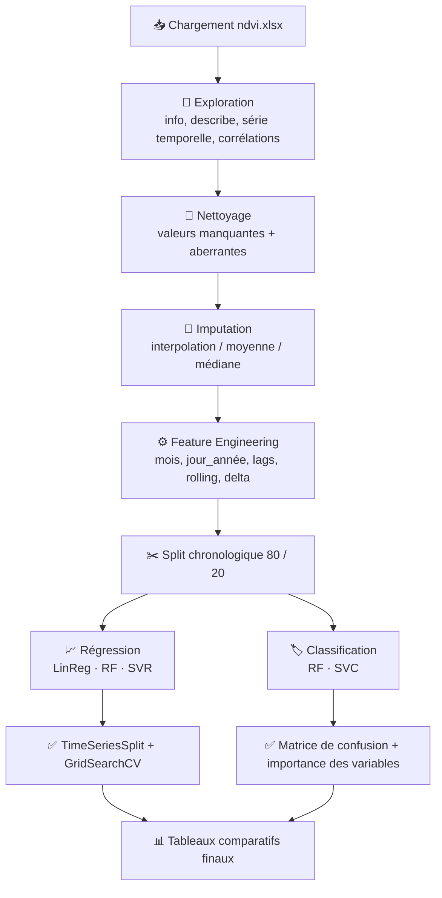

---

## 🧭 Démarche détaillée

### Étape 1 — Chargement et exploration
Chargement du fichier Excel, conversion de `date` en datetime, puis analyse de la structure (`info`, `describe`).

📄 Statistiques descriptives : [`results/statistiques_descriptives.csv`](results/statistiques_descriptives.csv)

### Étape 2 — Visualisation de la série temporelle
Évolution du NDVI moyen dans le temps pour repérer tendance, saisonnalité et anomalies.

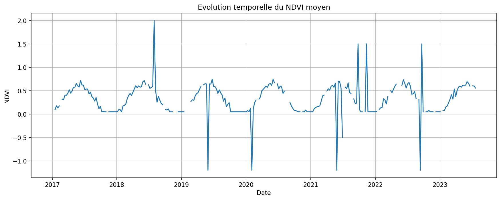

### Étape 3 — Analyse des corrélations
Identification des relations entre NDVI et variables climatiques, et des variables redondantes.

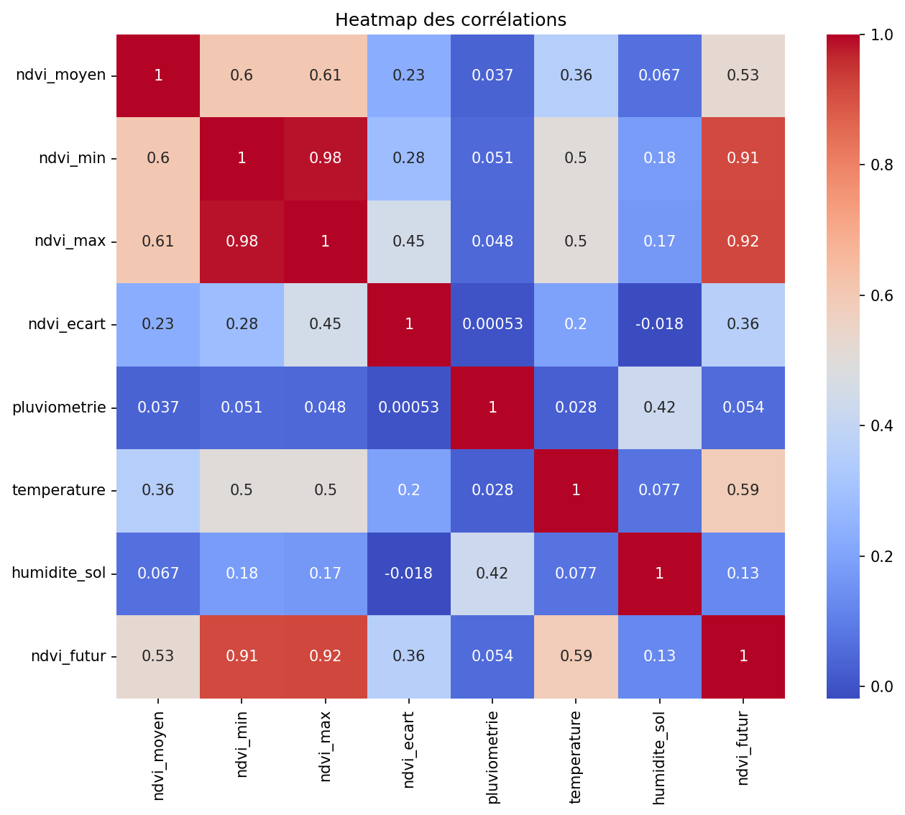

### Étape 4 — Valeurs manquantes
Comptage par variable avant nettoyage.

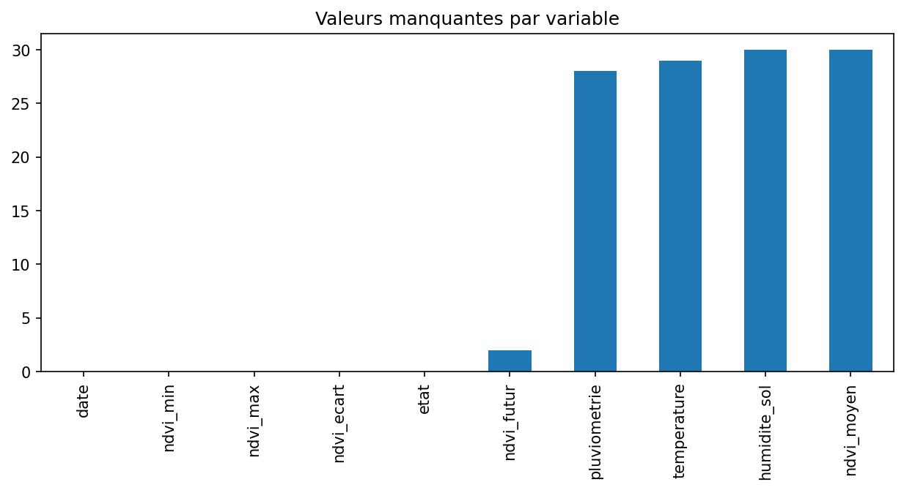

### Étape 5 — Valeurs aberrantes
Détection par règles métier ; les valeurs hors bornes sont converties en `NaN`. Comparaison avant / après (exemple : `temperature` et `ndvi_moyen`).

| Avant correction | Après correction |
|:---:|:---:|
| 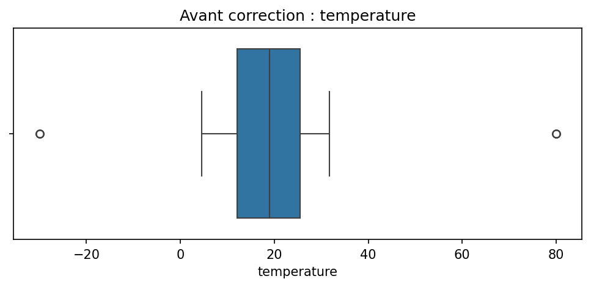 | 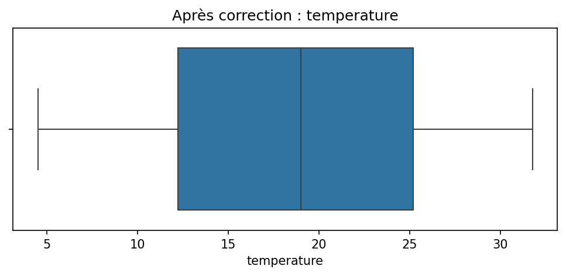 |
| 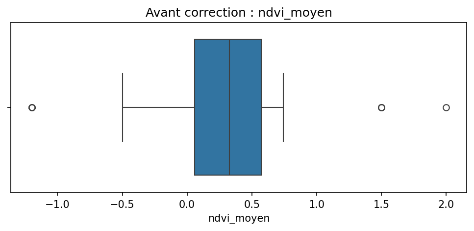 | 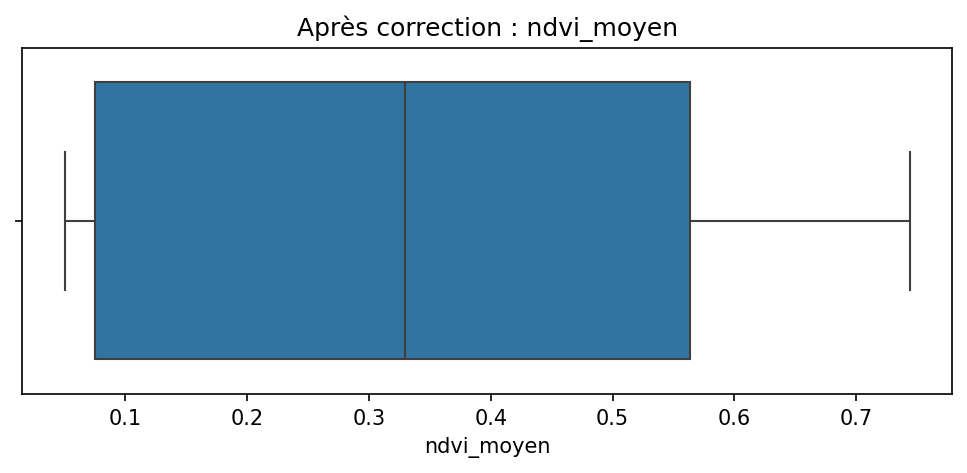 |

> Boxplots complets pour `pluviometrie` et `humidite_sol` dans le dossier [`images/`](images/).

### Étape 6 — Imputation

| Variable | Méthode | Justification |
|---|---|---|
| `ndvi_moyen`, `temperature` | Interpolation | Variables continues dans le temps |
| `humidite_sol` | Moyenne | Distribution relativement symétrique |
| `pluviometrie` | Médiane | Distribution asymétrique, robuste aux extrêmes |

### Étape 7 — Feature Engineering

| Variable créée | Définition |
|---|---|
| `mois`, `jour_annee` | Capture de la saisonnalité |
| `ndvi_lag1`, `ndvi_lag2` | NDVI aux pas de temps précédents |
| `ndvi_roll3` | Moyenne glissante sur 3 pas |
| `delta_ndvi` | Variation du NDVI |

### Étape 8 — Découpage chronologique
Split **80 % entraînement / 20 % test sans mélange**, pour éviter toute fuite d'information du futur vers le passé. Toutes les chaînes de traitement utilisent un `Pipeline` scikit-learn (`StandardScaler` + modèle).

### Étape 9 — Modèles de régression
Linear Regression (baseline), Random Forest Regressor et SVR.

| Linear Regression | Random Forest | SVR |
|:---:|:---:|:---:|
| 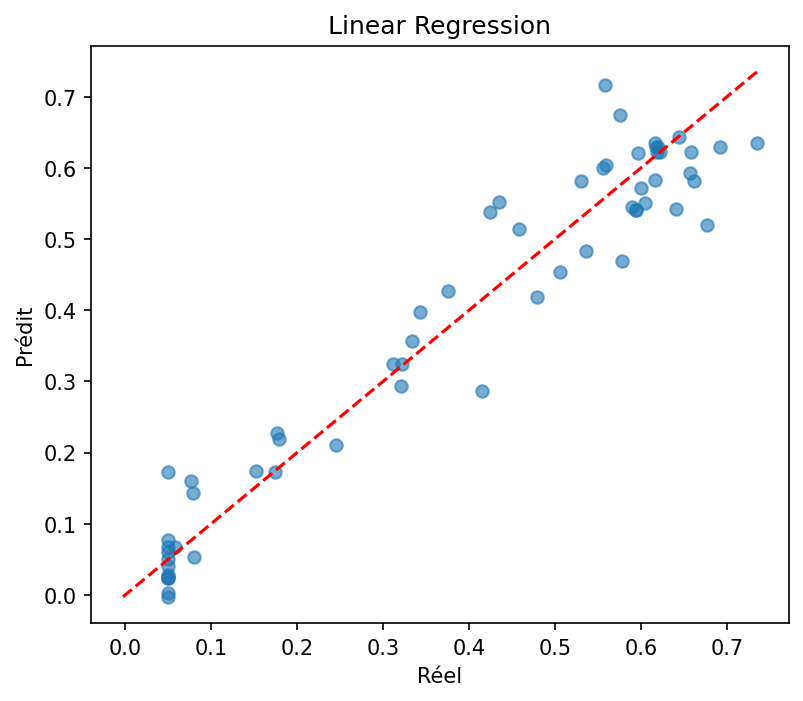 | 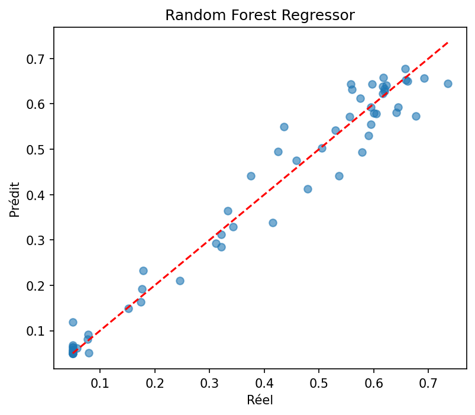 | 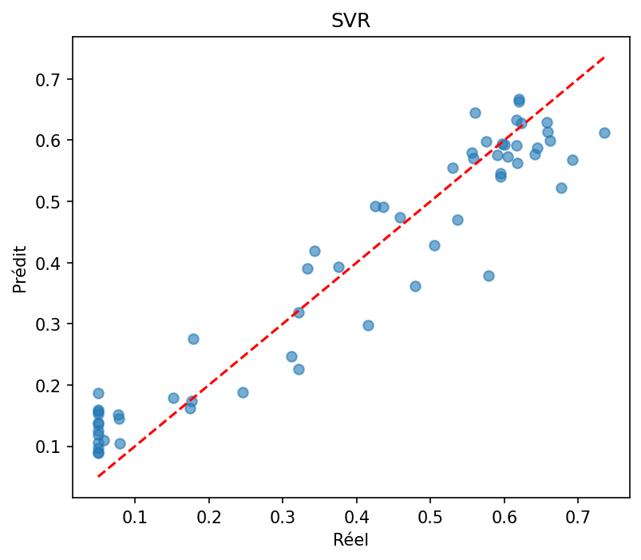 |

### Étape 10 — Validation croisée temporelle
`TimeSeriesSplit` (5 plis) appliqué au Random Forest pour mesurer la stabilité.

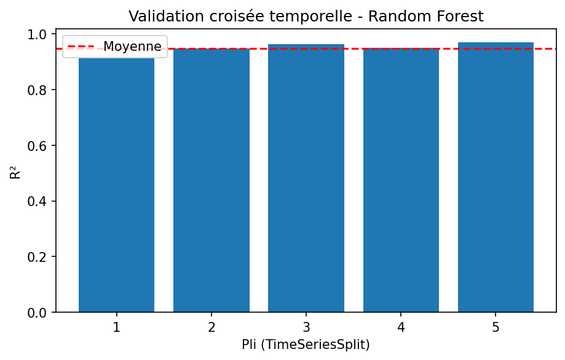

### Étape 11 — Classification
Random Forest Classifier et SVC, évalués par rapport de classification et matrice de confusion.

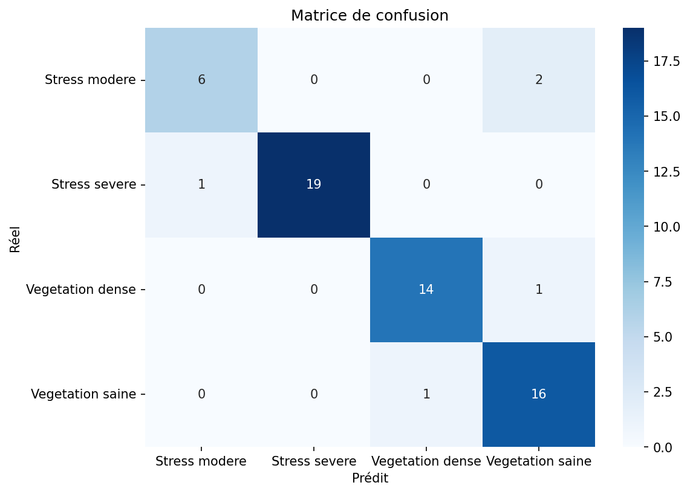

### Étape 12 — Importance des variables
Interprétation du Random Forest Classifier.

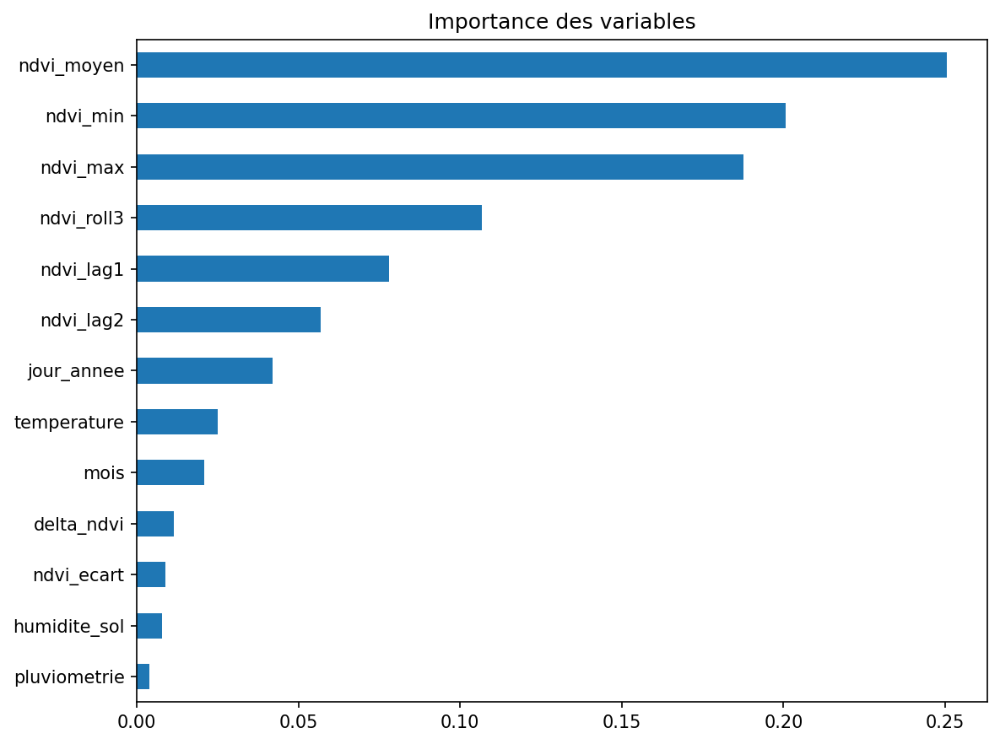

### Étape 13 — Optimisation des hyperparamètres
`GridSearchCV` sur le Random Forest Regressor : `n_estimators ∈ {100, 200, 300}` × `max_depth ∈ {5, 10, None}`.

---

## 📊 Résultats

> Les tableaux ci-dessous sont générés automatiquement par le notebook (dossier `results/`) puis insérés par `update_readme.py`.

### Régression (jeu de test)

<!--REG_TABLE-->

| Modèle                       |     R2 |   RMSE |    MAE |
|:-----------------------------|-------:|-------:|-------:|
| Linear Regression            | 0.9331 | 0.0621 | 0.0485 |
| Random Forest                | 0.9665 | 0.044  | 0.0319 |
| SVR                          | 0.9091 | 0.0724 | 0.0597 |
| Random Forest (GridSearchCV) | 0.9669 | 0.0436 | 0.0318 |

<!--/REG_TABLE-->

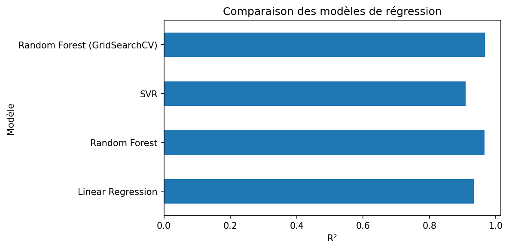

### Validation croisée — Random Forest (TimeSeriesSplit)

<!--CV_TABLE-->

|   Pli |     R2 |
|------:|-------:|
|     1 | 0.9136 |
|     2 | 0.9485 |
|     3 | 0.963  |
|     4 | 0.9495 |
|     5 | 0.9696 |

<!--/CV_TABLE-->

### Meilleurs hyperparamètres (GridSearchCV)

<!--GRID_TABLE-->

|   max_depth |   n_estimators |   R2_CV |
|------------:|---------------:|--------:|
|           5 |            300 |  0.9376 |

<!--/GRID_TABLE-->

### Classification (jeu de test)

<!--CLF_TABLE-->

| Modèle        |   Accuracy |   F1 pondéré |
|:--------------|-----------:|-------------:|
| Random Forest |     0.9167 |       0.9166 |
| SVC           |     0.8833 |       0.8844 |

<!--/CLF_TABLE-->

### 🔍 Interprétation

*( Interprétation

**Régression.** Les trois modèles prédisent bien le NDVI futur (R² entre 0,91 et 0,97). Le **Random Forest** est le meilleur (R² = 0,9665, RMSE = 0,044, MAE = 0,032), devant la régression linéaire (R² = 0,9331) et le SVR (R² = 0,9091). La bonne performance de la baseline linéaire s'explique probablement par la forte autocorrélation du NDVI : la valeur courante et les retards (`ndvi_lag1`, `ndvi_lag2`) portent déjà l'essentiel de l'information. Le Random Forest apporte un gain supplémentaire en capturant des relations non linéaires.

**Stabilité.** La validation croisée temporelle (5 plis) donne un R² compris entre 0,91 et 0,97 (moyenne ≈ 0,949), ce qui montre que le modèle généralise de façon stable dans le temps. Le premier pli, entraîné sur le moins de données, est le plus faible.

**Optimisation.** Le `GridSearchCV` retient `max_depth = 5` et `n_estimators = 300` (R² en validation croisée = 0,9376). Le gain sur le test est négligeable (0,9665 → 0,9669) : le Random Forest par défaut était déjà bien adapté.

**Classification.** Le Random Forest Classifier (accuracy = 0,917, F1 pondéré = 0,917) surpasse le SVC (accuracy = 0,883, F1 pondéré = 0,884). Le jeu de test étant de petite taille, l'écart correspond à quelques prédictions seulement et doit être interprété avec prudence.

**Variables importantes.** Le Random Forest Classifier s'appuie très majoritairement sur les variables dérivées du NDVI : `ndvi_moyen` (≈ 0,25), `ndvi_min` (≈ 0,20) et `ndvi_max` (≈ 0,19) cumulent à elles trois près de 65 % de l'importance, suivies de `ndvi_roll3`, `ndvi_lag1` et `ndvi_lag2`. La saisonnalité (`jour_annee`, `mois`) et la température ont un rôle secondaire, tandis que `humidite_sol`, `pluviometrie`, `ndvi_ecart` et `delta_ndvi` contribuent très peu. Ce résultat est cohérent avec une classe `etat` étroitement liée au niveau de NDVI, mais il confirme aussi le risque de dépendance évoqué dans la section « Limites ».

**Erreurs de classification.** Sur les 60 observations du jeu de test, 55 sont correctement classées et 5 seulement sont erronées. La classe **Stress sévère** est la mieux reconnue (19 sur 20) et n'est jamais confondue avec une classe de végétation. La classe **Stress modéré** est la plus difficile à identifier (6 sur 8, soit 75 % de rappel) : deux observations sont prédites en *Végétation saine*, ce qui correspond à des états voisins sur l'échelle du NDVI. Les deux classes de végétation (*dense* et *saine*) ne sont confondues qu'une fois dans chaque sens. Les effectifs par classe étant faibles, ces taux restent à interpréter avec prudence.
---

## ⚠️ Limites et pistes d'amélioration

- **Imputation avant découpage** : l'interpolation utilise des valeurs voisines, dont certaines futures ; une imputation réalisée uniquement sur le jeu d'entraînement serait plus rigoureuse.
- **Risque de fuite de données (classification)** : si `etat` est dérivé du NDVI via des seuils, les variables `ndvi_*` rendent la tâche quasi triviale ; à vérifier.
- **Hyperparamètres par défaut** pour SVR, SVC et le Random Forest Classifier : un `GridSearchCV` dédié pourrait améliorer les scores.
- **Pistes** : modèles dédiés aux séries temporelles (SARIMA, Prophet, LSTM), XGBoost / LightGBM, variables climatiques décalées, données multi-sites.

---

## 📁 Structure du dépôt

```
.
├── PROJET_ML_Ellaoui_Abdelhamid_IDSA_V3.ipynb   # Notebook principal
├── ndvi.xlsx                                    # Données (à placer à la racine)
├── update_readme.py                             # Insère les tableaux dans le README
├── requirements.txt
├── images/                                      # Graphes générés par le notebook
├── results/                                     # Tableaux CSV / Markdown générés
└── README.md
```

---

## 🚀 Installation et exécution

```bash
# 1. Cloner le dépôt
git clone https://github.com/<votre-utilisateur>/<nom-du-depot>.git
cd <nom-du-depot>

# 2. Créer un environnement virtuel
python -m venv .venv
.venv\Scripts\activate          # Windows
# source .venv/bin/activate     # macOS / Linux

# 3. Installer les dépendances
pip install -r requirements.txt

# 4. Lancer le notebook (placer ndvi.xlsx à la racine)
jupyter notebook PROJET_ML_Ellaoui_Abdelhamid_IDSA_V3.ipynb
```

---

## 🛠️ Technologies

Python · pandas · NumPy · Matplotlib · Seaborn · scikit-learn · Jupyter

---

## 👤 Auteur

**Ellaoui Abdelhamid** — IDSA
